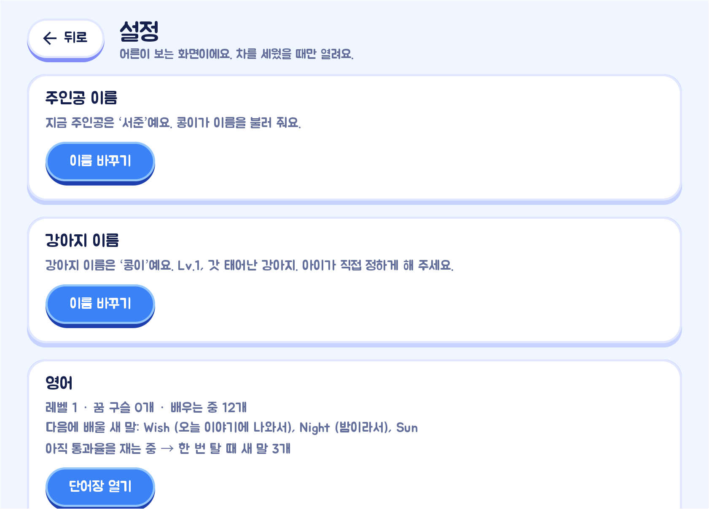
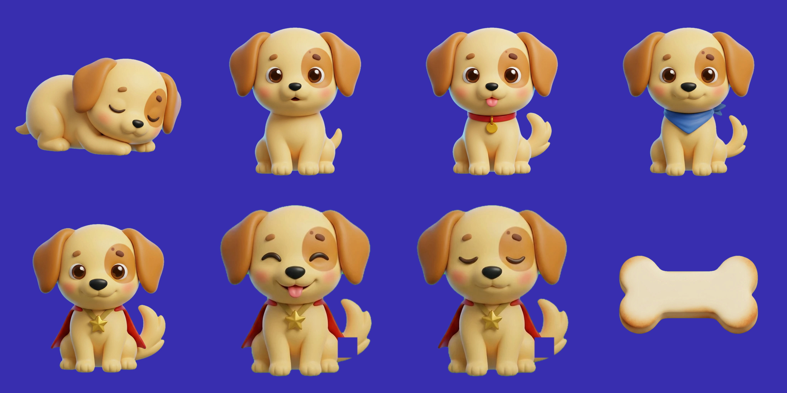
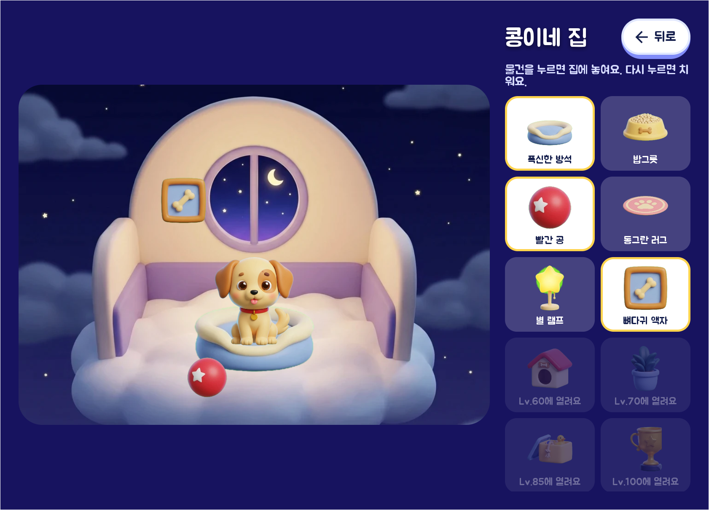
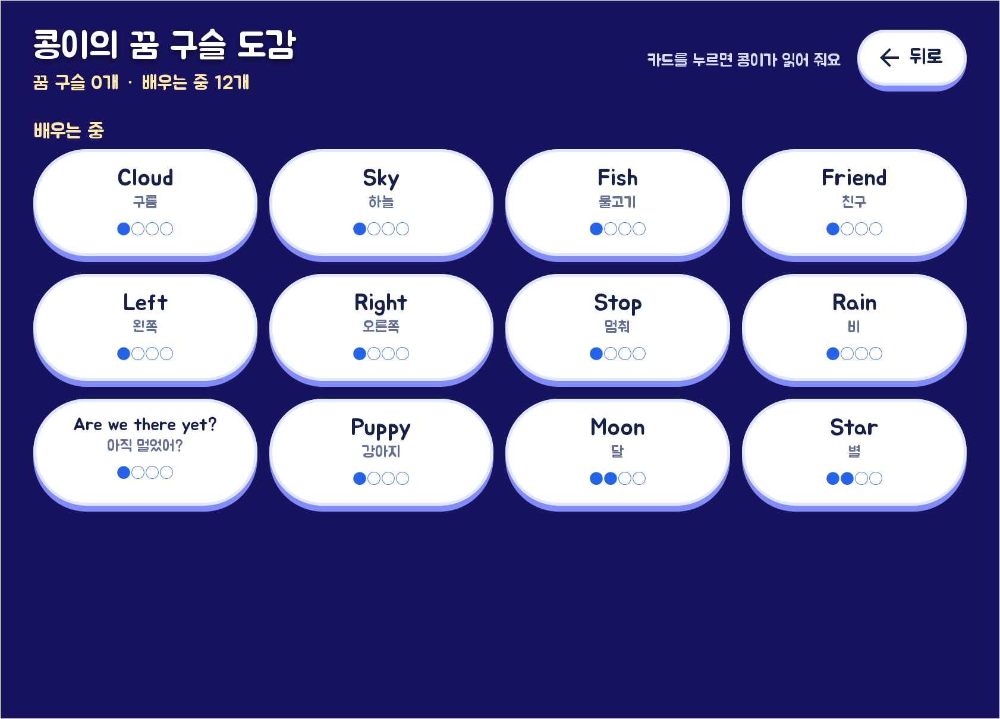

# 멍글리시

차가 들려주는 이야기. 뒷자리 아이에게 오디오 동화를 들려주고, 방향지시등·와이퍼·브레이크 같은
차량 신호가 올 때마다 이야기가 그에 맞춰 반응하며, 동화 사이사이에 영어를 가르치는 Pleos Connect 앱입니다.
영어를 한 가지 배울 때마다 구름 강아지의 간식이 생기고, 간식을 주면 강아지가 자랍니다.

> **한 줄 소개** — 차가 가르치는 영어, 배울수록 자라는 강아지. "아직 멀었어?"를 "벌써 다 왔어?"로 바꾸는 뒷자리 아이용 Pleos Connect 앱.

| 항목 | 내용 |
|---|---|
| 팀 | 커맨드아주 |
| 앱 이름 | 멍글리시 (v0.2.0, `com.ajikmeoreosseo.app`) |
| APK 파일 위치 | [`apk/커맨드아주_멍글리시_release.apk`](apk/커맨드아주_멍글리시_release.apk) (release 빌드) |
| 실행 방법 | [실행 방법](#실행-방법) |
| 테스트 환경 및 필요한 설정 | [테스트 환경 및 필요한 설정](#테스트-환경-및-필요한-설정) |
| 시연 영상 | [`docs/demo/ajik-meoreosseo-demo.mp4`](docs/demo/ajik-meoreosseo-demo.mp4) (2분 32초) |


| 이야기 속 | 로비에서 말로 간식 주기 | 설정(어른용) |
|---|---|---|
|  |  |  |

## 화면

- **홈**: 구름 위에 앉은 강아지, 인사 말풍선, 강아지 카드(이름·단계·다음 모습까지의 막대), 모은 꿈 구슬(누르면 도감),
  모은 간식의 개수(버튼이 아님), "콩이네 집", 큰 "이야기 시작" 버튼.
- **이야기 속**: "이야기 시작"을 누르면 화면이 강아지를 향해 동그랗게 닫히고 제목이 뜬 뒤 이야기 속에서 다시 열립니다.
  장 제목, 강아지의 말풍선(가르치는 영어는 크게), "아직 멀었어?" 버튼만 있습니다.
- **설정(어른용)**: 주인공 이름, 강아지 이름, 영어 단어장, 목소리 상태. 차를 세웠을 때만 열립니다.

글꼴은 [Jua](https://fonts.google.com/specimen/Jua)(SIL Open Font License, `licenses/Jua-OFL.txt`)를 씁니다.
디자인은 어린이 학습 앱에 권장되는 방향(말랑한 점토 느낌의 큼직한 버튼, 밝은 원색과 파스텔, 칭찬의 금색,
눌렀을 때 통통 튀는 반응)을 따랐습니다.

## 매일 새 이야기

세계관(구름이 된 차, 구름 강아지, 달빛 섬)은 같고, 가는 길의 모험은 날마다 다릅니다. 앱을 켜면(정차 중)
그날의 이야기를 Claude API로 씁니다(`story/StoryGenerator.kt`, `ai/ClaudeApi.kt`, 공식 Anthropic Java SDK. 기본 모델은 싸고 빠른
`claude-haiku-5-5`이고 `secrets.properties`의 `ANTHROPIC_API_KEY`, 모델은 `ANTHROPIC_MODEL`로 바꿀 수 있음).

- 날짜로 고른 모험 주제 20가지가 돌아가고, 최근 사흘 제목은 피합니다.
- **오늘 배울 영어의 우리말 뜻**을 이야기에 3~5개 녹여 넣습니다. 아이는 이야기에서 들은 말을 장 사이 영어 수업에서 다시 만납니다.
- 강아지 말투(아기·꼬마·다 자람)를 맞추고, 아이 이름·강아지 이름 자리표시자만 쓰게 합니다. 영어·무서운 내용·운전자에게 하는 말은 금지.
- 구조는 고정 이야기와 같습니다(6장, 장마다 3~5문장, 첫 장 뒤 안전벨트 확인, 장 사이 영어 수업 자리, 기다릴 때 놀이 5개, 결말 3문장).
  응답은 JSON 스키마(strict)로 받고, 장 수·문장 수·자리표시자를 검사해 어긋나면 버립니다.
- **내용 검사**: 영어 글자, 지시문에서 새어 나온 말("낱말", "단어" 등), 같은 말 반복, 숫자, 너무 긴 문장, "~라고 불러 줘" 같은
  어색한 문장을 찾습니다. 문제가 있으면 이유를 알려 주고 한 번 더 쓰게 한 뒤 나은 쪽을 고르고, 그래도 남은 문제 문장은 뺍니다.
- **남은 시간에 맞는 길이**: 내비 경로가 잡히면(홈 화면에 있을 때) 남은 시간에 맞는 크기(3분이면 4장×3문장, 10분이면
  10장×4문장, 최대 10장×6문장)로 이야기를 **미리** 다시 씁니다(길이 차이가 클 때만, 20초쯤). 그래서 "이야기 시작"을 누르면
  바로 시작하고(쓰는 중이면 제목 카드를 띄운 채 최대 15초 기다림), 도착 전에 결말까지 듣습니다. 3분 경로에서 본문이 2분 15초에
  끝나는 것을 확인했습니다. 경로가 없으면 6장×4문장입니다. 긴 이야기(30문장 초과)는 빨리 쓰도록 추론을 최소로 합니다.
- 만든 이야기는 기기에 날짜별로 저장해 그날은 다시 만들지 않습니다(설정의 "다른 이야기로 다시 쓰기"로 바꿀 수 있음).
  키가 없거나 통신이 안 되거나 검사에 걸리면 기본 이야기 「구름 강아지와 달빛 섬」을 들려줍니다.
- **오늘 있었던 일**: 설정에 적어 두면(100자까지, `story/TodayNote.kt`) 그 내용을 넣어 오늘의 이야기를 다시 씁니다. 첫 장에서 강아지가
  "{이름아}, 오늘 ~했다며? 어땠어?" 하고 묻고 5초 기다린 뒤 마음을 받아 주며, 모험 중간과 결말에서 한 번씩 이어 갑니다. 적은 글은 다음 날 저절로
  사라지고, 이야기를 쓰려고 Claude(Anthropic)로 보내집니다(입력 창에 안내). 키가 없거나 기본 이야기로 넘어가면 들어가지 않습니다.
- 모델이 "{멍}은"처럼 표시 뒤에 조사를 따로 쓰거나 "{멍이가}"처럼 겹쳐 써도 앱이 올바른 표시로 고칩니다.
- 비용: 이야기 한 편에 입력 약 3천 토큰, 출력 약 2천 토큰으로 Haiku 5.5(입력 100만 토큰에 0.1달러, 출력 0.5달러)면 2~3원, 걸리는 시간은 30초 안팎입니다(경로가 잡히면 미리 써 둡니다). 새 문장의 음성은 ElevenLabs로
  처음 한 번 만들어지므로 날마다 2천 자쯤 음성 요금이 듭니다.

## 동작

| 차량 신호 | 이야기의 반응 | 사용 SDK |
|---|---|---|
| 방향지시등 좌/우 | 화면의 구름과 강아지가 그쪽으로 기울고, 읽던 문장이 끝나면 "구름이 왼쪽으로 스르르 기울었어요." | Vehicle · TurnSignal |
| 와이퍼 켜짐/꺼짐 | 비 오는 장면 / 비가 그침 | Vehicle · Wiper |
| 브레이크 4초 이상 | 신호 대기 중 숨 고르기 놀이, 떼면 "다시 출발" | Vehicle · Brake |
| 기어 R | 뒷걸음질 대사 | Vehicle · Gear |
| 주행 후 기어 P, 또는 내비 도착 | 마무리 장면 | Vehicle · Gear, NaviHelper |
| 뒷좌석 착석 + 벨트 미착용 | 벨트를 맬 때까지 이야기를 멈춤 | Vehicle · Seat |
| 도착 후 뒷문 열림 | "천천히 내려요" | Vehicle · Door |
| "아직 멀었어?" 버튼 | 남은 시간을 이야기 속 말로 대답 | NaviHelper |
| 내비 음성 안내가 나올 때 | 읽던 말을 멈췄다가 이어 읽고, 안내 내용을 이야기로 받아 줌: 회전은 다 돈 뒤에 "길 안내 요정이 알려 준 대로 구름이 오른쪽으로 돌았어요", 그 밖에는 "여기 하늘 길은 60까지만 날 수 있대", "달빛 섬까지 7분이면 도착이래" | AudioManager 오디오 포커스 + NaviHelper · TBTInfo, CurrentRoadSpeedLimit, CameraAlert, DrivingInfo |

주행 중(P단이 아닐 때)에는 말풍선을 숨기고 소리로만 전달합니다(밤에 밝은 흰 말풍선이 눈부시지 않게).

**운전을 방해하지 않는 반응**: 차가 움직인 순간에는 소리를 내지 않습니다(화면의 구름만 기웁니다). 읽던 문장이 끝난 뒤
이야기 속 말로 한 문장만 덧붙이고, 같은 반응은 정해진 간격(깜빡이 25초)과 한 번 탈 때의 횟수(깜빡이 3번, 비·후진 1번,
그 밖 2번)를 넘기지 않습니다. 그 움직임의 영어는 다음 장 사이 수업에서 "아까 구름이 왼쪽으로 기울었지? '왼쪽'. 영어로는, Left."
하고 떠올리며 가르칩니다. 몸으로 느낀 일과 이어진 말이라 귀에 들어오고, 운전자는 갑작스러운 외침을 듣지 않습니다.

**어른만 아는 비밀 버튼**: 이야기를 듣는 중에 왼쪽 위 장 제목을 길게 누르면 강아지가 읽던 말을 멈추고 우는 아이를 달랜 뒤 이어 읽습니다
(`StoryEngine.calmChild`, 대사는 `Reactions.calm`). 달리는 중에는 화면을 오래 누르지 않도록 한 번만 톡 누르면 됩니다
(뒷자리 아이 손은 닿지 않습니다). 평범한 장 제목처럼 보여 아이는 모르고, 설정 화면에만 안내가 있습니다.
달래는 말은 겁을 주거나 울음을 참으라고 하지 않습니다. "속상했구나. 괜찮아, 콩이가 옆에 있어."처럼 마음을 먼저 받아 주고,
곁에 있다고 말한 뒤 숨 고르기나 다음에 할 일로 마음을 돌려 줍니다.

내비 안내는 차가 이미 제 목소리로 하므로 앱이 숫자를 따로 읽지 않습니다. 대신 내비(또는 전화 등)가 소리를 내는 동안 낭독을
멈추고, 끝나면 멈춘 자리부터 이어 읽습니다(`ElevenLabsVoice.onFocusChange`). 멈춰 있는 동안은 시간 초과로 다음 문장으로
넘어가지 않습니다. 이어 읽은 뒤에는 방금 들린 안내를 **이야기 속 말로 받아 줍니다**(`StoryEngine.onNaviSpoke`):
운전자가 가장 집중해야 할 때는 말을 보태지 않습니다. 1km 안의 회전 안내는 말없이 기억했다가 그 길을 다 지나고 4초 뒤에
"길 안내 요정 말대로 구름이 왼쪽으로 돌았어요."처럼 지난 일로 받아 주고(한 번 탈 때 4번까지), 과속 카메라가 700m 안에 있으면
아무 말도 하지 않습니다. 그 밖에는 제한 속도 → 남은 시간 순으로 받아 주며, 40초에 한 번까지입니다.
내비 소리가 오디오 포커스를 가져가지 않는 차에서도 회전이 1km 안으로 들어오면 같은 방식으로 기억해 둡니다.
차량 기본 음성으로 읽을 때는 Pleos TTS 서비스의 처리에 맡깁니다.

## 강아지 키우기

아이가 키우는 구름 강아지(기본 이름 '콩이', 설정에서 아이가 정한 이름으로 바꿀 수 있음)가 이야기의 길동무입니다.

- 이야기 속에서 영어를 한 가지 배울 때마다 **간식**이 하나 생깁니다(한 말을 완전히 익혀 꿈 구슬이 되면 3개).
  차 안의 말수를 줄이려고 "딩동! 콩이의 간식이 하나 생겼어."는 한 번 탈 때 처음 한 번만 말하고("앞으로 생기는 간식은
  모아 뒀다가, 도착하면 한꺼번에 줄 수 있어."), 그 뒤의 간식은 조용히 쌓았다가 도착하면 모은 개수를 말해 줍니다.
- 간식은 이야기 속에서 모으고, **로비(홈)로 돌아와서 줍니다.** 도착하면 강아지가 "오늘 모은 간식은 2개! 이따가 콩이한테
  'Here you are!' 하고 말해 주면 받아먹을게."라고 개수만 알려 줍니다.
- 로비에는 간식 주기 버튼이 없고 **모은 간식의 개수만** 보입니다. 아이 손은 앞자리 화면에 닿지 않으므로 **말로 줍니다**.
  로비에 오면(앱을 켰을 때, 이야기에서 돌아왔을 때, 차를 세웠을 때) 간식이 있으면 강아지가 먼저 "간식이 2개 있네! 콩이한테 간식을
  줄 때는 영어로 이렇게 말해. Here you are!" 하고, 아이가 뒷자리에서 "Here you are!"라고 말하면 차가 듣고 모은 간식이 하나씩
  강아지에게 날아갑니다. 못 들었으면 "어? 잘 안 들렸어. 한 번 더 크게 말해 볼까?" 하고 한 번 더 묻고, 두 번 다 못 들으면
  차 마이크가 뒷자리 소리를 못 들었을 수도 있으므로 "목소리가 작아서 잘 안 들렸지만, 콩이가 알아들었대!" 하고 그래도 줍니다.
  한 번 로비에 올 때 한 번만 묻고, 주행 중이거나 이야기를 시작하면 멈춥니다. 음성 인식이 없는 차에서는 로비에 오면 그냥 줍니다.
  간식 하나에 한 단계씩 자라고, 다 먹고 나면 자란 소식이나 새 물건 소식을 한 번에 알려 줍니다.
- 단계가 쌓이면 모습이 바뀝니다(빛이 번쩍이는 성장 연출).

| 단계 | 모습 |
|---|---|
| 1 | 갓 태어난 강아지(눈 감고 잠) |
| 10 | 아기 강아지 |
| 30 | 꼬마 강아지(빨간 목걸이) |
| 60 | 소년 강아지(파란 스카프) |
| 100 | 다 자란 강아지(빨간 망토와 별 메달) |



15분 가는 길에 영어를 5~7가지 배우므로(10분마다 3개 기준, 아래 "배우는 양"), 보통 열다섯 번쯤 타면 다 자랍니다. 다 자란 뒤에도 간식은 먹습니다.
진도는 기기 안(`pet` 환경설정)에만 저장됩니다. 규칙은 `pet/Pet.kt`, 연출은 `ui/SceneView.kt`에 있습니다.

**자라면 달라지는 것**

- **영어 난이도**: 강아지의 다섯 모습이 영어의 다섯 레벨과 짝을 이룹니다. 아기 강아지(10단계)가 되면 레벨 2(모든 단어),
  꼬마 강아지(30단계)는 레벨 3(짧은 표현), 소년 강아지(60단계)는 레벨 4(문장), 다 자란 강아지(100단계)는 레벨 5(묻는 말과 긴 문장).
  지금 레벨이 그보다 낮으면 끌어올리며 "이제 조금 더 어려운 영어도 배울 수 있어!"라고 말합니다. 새 모습으로 자랄 때 한 번만 올리므로,
  그 뒤에 어른이 직접 고르거나 레벨 테스트로 낮춘 레벨은 그대로 남습니다. 이미 배우던 말의 복습은 레벨과 상관없이 이어집니다.
- **말투**: 아기(1~2단계)·꼬마(3~4단계)·다 자람(5단계)에 따라 첫인사, 홈 인사, 놀이 하나, 결말, 영어 수업 첫마디가 바뀝니다
  (`story/Story.kt`의 `Tone`). 동화 본문은 같습니다.

**집 꾸미기** — 홈의 "콩이네 집"(차를 세웠을 때만)으로 들어가면 구름 위의 방이 나옵니다.
방 안 물건은 단계가 오를 때마다 하나씩 열립니다(5 방석, 10 밥그릇, 20 공, 30 러그, 40 별 램프, 50 액자,
60 개집, 70 화분, 85 장난감 상자, 100 트로피). 열린 물건은 오른쪽 상자에서 누르면 방의 정해진 자리에 놓이고,
다시 누르면 치워집니다. 새 물건이 열리면 간식을 줄 때 알려 주고 홈 버튼에 "새 물건!" 표시가 붙습니다.
규칙과 자리는 `pet/House.kt`, 화면은 `ui/HouseView.kt`입니다.



## 동화 사이사이의 영어

구름 강아지가 동화 장과 장 사이에 영어를 한 가지씩 가르칩니다. 차가 실제로 움직인 순간에는 그 움직임을 영어로 알려 줍니다.

**이야기 속 영어 메아리** (`story/StoryEcho.kt`): 수업 시간 말고도 이야기를 듣는 내내 영어를 만나도록, 이야기 문장에
아이가 배운(또는 오늘 배울) 낱말이 나오면 그 문장 바로 뒤에 영어 한마디를 덧붙입니다.
"저기 하늘에 달이 둥실 떠 있어." → "Moon!" 문장 안의 낱말을 바꾸지 않아 조사가 깨지지 않습니다.
한 장에 한 번, 한 이야기에 8번까지이고, 익힌 낱말이 늘수록 메아리도 늘어납니다.

| 언제 | 무엇을 |
|---|---|
| 장과 장 사이 | 이야기에 나온 말: Puppy, Moon, Star … |
| 왼쪽·오른쪽 깜빡이 뒤 다음 수업 | Left / Right |
| 신호 대기, 다시 출발 뒤 다음 수업 | Stop / Go |
| 와이퍼 뒤 다음 수업 | Rain |
| 안전벨트를 맨 뒤 다음 수업 | Seatbelt |
| 후진 뒤 다음 수업 | Back |
| "아직 멀었어?" 버튼 | Are we there yet? |
| 도착 | 오늘 만난 말을 한 번 더 |

**아이가 말하면 듣고 통과** (`english/AnswerListener.kt`, Pleos SpeechToText SDK ON_DEVICE, 권한 `pleos.car.permission.STT_SERVICE`)

- 영어를 물은 뒤 4.5초 동안 차량 마이크로 듣습니다(영어 인식, `en-US`). 들은 말이 기대한 말과 비슷하면 통과입니다.
  발음이 서툴러도 통과하도록 글자 거리로 느슨하게 비교하고, 여러 낱말은 내용어의 6할이 들리면 통과합니다.
- 처음 배우는 말은 못 들으면 한 번 더 따라 하게 하고, 그래도 안 되면 "괜찮아, 다음에 또 해 보자". 복습은 "정답은, Sky. 내일 또 물어볼게!"
- **통과하면 간식 하나, 못 들으면 반 조각**입니다(반 조각 둘이 모이면 하나). 마이크가 뒷자리 소리를 못 듣는 차에서도
  강아지가 계속 자라게 하기 위해서입니다. 진도(만난 날 수)는 통과와 상관없이 이어져 복습 일정이 끊기지 않습니다.
- 정차 중에는 듣는 동안 "🎤 따라 말해 봐!" 옆에 **"잘 말했어요"** 버튼이 떠서, 차가 못 들었어도 어른이 통과시켜 줄 수 있습니다.
- 음성 인식을 쓸 수 없는 차(권한 없음, 엔진 없음, 영어 미지원)에서는 예전처럼 잠깐 기다린 뒤 통과로 봅니다.
- 확인: 에뮬레이터의 차량 내 인식 엔진에 영어 음성(합성한 "Right")을 넣어 `heard: "right"` → 통과 → "맞아! Right" → 간식 하나,
  아무 소리도 없을 때 시간 초과 → 정답 들려주기 → 반 조각을 확인했습니다. 실제 아이 목소리와 뒷좌석 거리에서는 아직 확인하지 못했습니다.
  SDK에는 좌석별로 골라 듣는 기능이 일반 앱에 열려 있지 않습니다(음원 분리·화자 설정은 privileged 앱 전용).

**아이 귀에 맞춘 전달**

- 차의 움직임(깜빡이, 정지·출발, 비, 벨트, 후진)과 묶인 영어는 그 순간이 아니라 다음 장 사이 수업에서
  "아까 ~했지?" 하고 떠올리며 가르칩니다(위 "운전을 방해하지 않는 반응").
- 영어는 음높이를 그대로 두고 0.8배로 느리게 들려줍니다(`ElevenLabsVoice.SLOW_PLAYBACK`). 우리말은 보통 빠르기입니다.
- 느리게 들려주기는 ElevenLabs 음성으로 읽을 때만 됩니다. 차량 기본 음성으로 넘어가면 영어는 보통 빠르기입니다.

**진도 규칙** (`english/EnglishCoach.kt`)

- 한 가지 말은 **서로 다른 날에 네 번** 만나면 '꿈 구슬'(완전히 익힌 말)이 됩니다.
  1일째 새로 배움 → 다음 날 복습(우리말→영어) → 그다음 날 복습(영어→우리말) → 이틀 뒤 마지막 확인.
- 꿈 구슬이 된 말은 날마다의 복습에서 빠지고, 그 자리는 아직 안 배운 새 말이 채웁니다.
- **꿈 구슬 닦기**: 잊지 않았는지 꿈 구슬이 된 지 2주 뒤, 그리고 그로부터 한 달 뒤에 한 번씩 다시 묻습니다(한 번 탈 때 하나).
  맞히면 구슬이 그대로 남고 간식 하나, 다른 말로 대답하면 구슬이 흐려져 배우는 말로 돌아갑니다.
  아무 말도 못 들었으면 차가 못 들었을 수 있으므로 그대로 두고 다음에 다시 묻습니다.
- 한 번 탈 때 얼마나 배울지는 "10분마다 몇 개" 설정이 정합니다(아래 '배우는 양'). 같은 말을 하루에 두 번 묻지 않습니다.
- **난이도는 다섯 레벨**(`english/Levels.kt`): ① 첫 단어(이야기·창밖·동물·먹을 것·색깔·수의 쉬운 단어 370) → ② 단어 넓히기(꾸미는 말,
  움직이는 말, 몸·집·자연·사람까지 723) → ③ 짧은 표현(164) → ④ 문장(83) → ⑤ 묻는 말과 다섯 낱말 이상의 긴 문장(57).
  단어장에는 말의 종류(낱말·짧은 표현·문장)만 적고 난이도는 규칙으로 정하므로, 익힌 낱말로 만든 문장에도 같은 규칙이 통합니다
  ("A red dog" 3, "I see a dog." 4, "Where is the dog?" 5). 지금 레벨의 새 말을 다 꺼내면 자동으로 올라가고, 강아지가 자라도 올라갑니다.
- 수록된 말은 1,419가지: 낱말 1,101(집·장난감 131, 동사 125, 형용사 110, 동물 109, 먹을 것 101, 창밖에 보이는 것 86,
  자연 80, 몸·옷 74, 때·학교 71, 사람 57, 차와 길 48, 이야기에 나오는 것 33, 공룡과 상상 27, 수 26, 색깔 15, 차의 움직임 8),
  짧은 표현 171, 문장 147. 차의 움직임과 묶인 말 22가지 포함.
- **끝이 없는 문장**: 레벨 3부터는 새 말을 세 갈래에서 번갈아 꺼냅니다. 지금 레벨까지의 손으로 쓴 표현·문장, 낱말(레벨이 올라도 계속),
  그리고 **아이가 익힌 낱말을 엮어 만든 문장**(`english/Sentences.kt`). Dog·Big·Red를 익혔다면 "A red dog", "The dog is big.",
  "I see a dog.", "Where is the dog?" 같은 말이 새로 나옵니다. 틀 21가지 × 익힌 낱말 수만큼 늘어나므로 낱말이 늘수록 문장도 늘어납니다.
  우리말은 받침에 맞춰 조사를 붙입니다("개가 보여요", "공이 보여요").

**레벨 테스트** (어른용, 설정 → "레벨 테스트", 정차 중에만. `ui/LevelTestDialog.kt`, `english/LevelExaminer.kt`): 아이에게 맞는 레벨(1~5)을 알아봅니다.

- 강아지가 우리말을 말하면("'사과'. 영어로 뭐라고 할까?") 아이가 영어로 대답하고, 차가 듣고(SpeechToText) 맞았는지 봅니다.
  차 마이크가 뒷자리 소리를 못 들을 수 있으므로 어른이 언제든 "알아요" / "몰라요"를 눌러 대신 정할 수 있고, 못 들었을 때는
  틀린 것으로 넘기지 않고 어른이 누를 때까지 기다립니다.
- **Claude가 출제합니다**(Anthropic API 키가 있을 때, 공식 Java SDK `com.anthropic:anthropic-java`, 모델 `claude-haiku-5-5`):
  문제마다 Claude에게 지금까지의 대답과 낼 수 있는 문제 목록(앱 단어장에서 레벨마다 8개)을 보내면, Claude가 아이의 대답을 보고
  다음 문제를 고릅니다. 잘하면 레벨을 건너뛰고, 헷갈리면 같은 레벨을 한 번 더 확인해 4~8문제 안에 끝내고, 레벨과 함께 부모에게
  보여 줄 한두 문장("단어는 잘 알아요. 짧은 표현부터 시작할게요.")을 정합니다. 차가 알아들은 글자도 함께 보내므로, 인식기가
  잘못 알아들은 대답("Flower"를 "flour"로)도 헤아립니다. 응답은 정해진 형식(JSON 스키마)으로만 받고, 목록에 없는 문제나
  이미 낸 문제를 고르면 받아들이지 않습니다. 보내는 것은 문제·정답 여부·알아들은 글자뿐이고 아이 이름과 목소리는 보내지 않습니다.
- **키가 없거나 통신이 안 되면 기본 테스트**가 그 자리에서 이어받습니다: 한 레벨에 두 문제씩, 둘 다 맞히면 다음 레벨로, 하나라도
  모르면 그 레벨에서 끝(2~10문제).
- 끝나면 결과 레벨을 바로 적용하고, 맞힌 말은 이미 아는 말이므로 꿈 구슬로 넣어 다시 가르치지 않습니다(2주 뒤 꿈 구슬 닦기에서 확인).
  이미 배우는 중이거나 익힌 말, 차의 움직임과 묶인 말은 문제로 내지 않습니다.
- 그 뒤로는 타면서 맞춥니다(아래 '무엇을 얼마나 배울지'). 레벨 테스트로 출발점을 잡고, 주행 중 통과율로 양을 조절하는 방식입니다.
- 에뮬레이터에서 확인: 기본 테스트로 두 문제를 맞히고 두 문제를 모르면 레벨 2로 저장되고 맞힌 두 말이 꿈 구슬로 들어감, 듣기 시간이
  지나면 어른의 답을 기다림, 잘못된 키로 Claude를 부르면(401) 기본 테스트가 이어받아 첫 문제가 나옴.
  Claude 출제: 쉬운 단어 다섯(고양이·바나나·크다·뛰어요·딸기)을 맞히고 짧은 표현 둘(큰 트럭·이거)을 모르자 일곱 문제 만에 레벨 3으로 끝내고
  "고양이, 바나나, 딸기, 크다 같은 단어를 자신 있게 말했어요. 짧은 구절부터 차근차근 배우도록 3단계에서 시작할게요."라고 적음.
  한 문제를 고르는 데 2~5초가 걸렸고, 그동안 강아지가 "맞아!" 하고 말합니다.


**배우는 양** (어른용, 설정 → "배우는 양"): 10분마다 영어를 몇 개 배울지(복습 포함) 1~5개 가운데 고릅니다. 기본은 3개입니다.

- 출발하자마자 하나, 그 뒤로 10분마다 고른 수만큼 수업이 나옵니다(`EnglishCoach.nextLesson`). 그래서 이동이 길수록 그만큼 더 배웁니다:
  3개 기준 15분이면 5개쯤, 1시간이면 19개쯤. 아직 차례가 아니면 장과 장 사이는 쉬어 가고, 동화가 끝난 뒤에도 시간이 되면 수업이 이어집니다.
- 복습할 말을 먼저, 그 사이사이에 새 말을 섞습니다. 한 번 탈 때 새 말은 12개까지만 배웁니다(1시간을 넘겨도).
- 5개를 고르면 "5개는 아이가 지루해하거나 힘들어할 수 있어요"라는 주의 글이 진하게 표시됩니다.
- 차의 움직임을 떠올리며 배우는 말(Left, Stop 등)은 이 수와 따로 셉니다.
- 에뮬레이터에서 확인: 5개로 두면 첫 수업은 출발 직후, 두 번째 수업은 2분 뒤에 나옴.

**무엇을 얼마나 배울지** (`english/WordPicker.kt`, `EnglishCoach.record`): 낱말이 천 개가 넘으므로 적힌 순서대로 내지 않습니다.

- **상황에 맞는 낱말 먼저**(한 번에 최대 2개, 이유마다 하나): 내비 목적지 이름에 든 말("서울숲공원" → Park) → 와이퍼가 켜져 있으면
  Umbrella·Puddle → 오늘 이야기 주제에 나오는 말("별똥별이 떨어뜨린 소원 조각" → Wish) → 시간대(밤이면 Moon·Star) →
  계절(가을이면 Leaf·Acorn). 아이가 지금 보고 듣는 것과 이어져야 귀에 들어오기 때문입니다.
- **나머지는 주제를 돌아가며**: 지금까지 가장 적게 배운 주제에서 하나씩 꺼냅니다. 동물만 수십 개 이어지지 않고, 색깔·형용사가
  일찍 섞여 익힌 낱말로 문장을 만들 수 있게 됩니다.
- **아이 속도에 맞춘 양**: 최근 따라 말하기 10번의 통과율이 50% 미만이면 새 말을 줄여 복습 둘에 새 말 하나꼴로 섞고(한 번 탈 때 새 말 4개까지),
  가장 익숙한 복습부터 묻습니다. 차가 들을 수 없는 경우는 통과율에 넣지 않습니다.
- **이동 중에도 조절**: 두 번 연달아 못 하면 그날 남은 새 말을 그만 내고 "오늘 새 말은 여기까지 하고, 아는 말로 놀자!",
  세 번 연달아 맞히면 새 말을 하나 더 냅니다(10분마다 정한 수와 따로).
- **레벨 올리기**: 통과율이 50% 미만인 동안에는 강아지가 자라도 다음 레벨로 넘어가지 않고, 다시 잘하게 되면 올립니다.
- 설정의 영어 카드에 레벨, "다음에 배울 새 단어: Park (공원에 가는 길이라서), Umbrella (비가 와서), Puppy", 통과율, 마지막 레벨 테스트 날짜가 보입니다.
- 에뮬레이터에서 확인: 가을 낮 → Wish·Leaf·Puppy, 비 + 목적지 공원 → Park·Umbrella·Puppy, 두 번 연달아 못 했을 때 새 말 중단.
- 문장에 어울리지 않는 낱말(Monday 같은 때를 나타내는 말, Weather 같은 셀 수 없는 생각, Pants처럼 늘 여럿인 말)은 문장 만들기에서 뺍니다.

**꿈 구슬 도감** (아이용, 홈의 꿈 구슬 표시를 누르면, 정차 중에만): 배운 말이 카드로 모입니다.
배우는 중인 말은 흰 카드에 구슬 점(●○○○), 꿈 구슬이 된 말은 금색 카드. 카드를 누르면 강아지 목소리로
영어, 이어서 우리말을 읽어 줍니다(이미 받아 둔 음성을 다시 씁니다).



**단어장 화면** (어른용, 설정 → "단어장 열기"): 아이 수준(레벨 1~5) 직접 고르기, 배우는 말과 꿈 구슬 보기,
말마다 "이미 알아요" / "다시 배우기"로 바로잡기, 영어 수업 켜고 끄기.
디버그 빌드에는 다음 날 복습을 바로 볼 수 있는 "시연용: 다음 날로 넘기기"가 있습니다.

진도는 '만난 날 수'로 올라가고(통과 여부는 간식과 양 조절에 씁니다), 어른이 단어장에서 바로잡을 수 있습니다.
말을 더하거나 고치려면 `english/WordBank.kt`만 바꾸면 됩니다.

## 아이가 주인공

화면의 "주인공 이름 정하기"에서 아이 이름을 넣으면(차를 세웠을 때만 가능) 이야기 전체가 그 아이의 이야기가 됩니다.

- 강아지가 이름을 불러 줍니다. 받침에 맞춰 "서준아 / 지우야", "서준이가 / 지우가"처럼 자연스럽게 바뀝니다.
- 이름 첫 글자를 별 물고기가 하늘에 그려 주고, 달빛 섬에는 아이 이름이 적힌 꿈 구슬이 기다립니다.
- 이름 글자 수와 첫 글자로 하는 놀이가 추가됩니다.

이름을 정하지 않으면 "우리 친구"로 부릅니다. 이름은 기기 안에만 저장됩니다.

## 목소리

| 순서 | 목소리 | 조건 |
|---|---|---|
| 1 | ElevenLabs | `secrets.properties`에 API 키가 있고 통신이 될 때 |
| 2 | Pleos TextToSpeech SDK (ON_DEVICE) | 키가 없거나, 통신이 끊겼을 때 자동 전환 |

ElevenLabs를 쓰려면 `secrets.example.properties`를 참고해 `secrets.properties`를 채운 뒤 다시 빌드합니다.

- `ELEVENLABS_API_KEY` — 필수.
- `ELEVENLABS_VOICE_ID` — 비워 두면 내 계정의 목소리 중 이름·설명이 귀여운 쪽을 앱이 고릅니다.
  API 키에 목소리 목록 읽기 권한(voices_read)이 없으면 기본 제공 목소리(Jessica)로 읽습니다.
  원하는 목소리가 있으면 ElevenLabs의 My Voices에서 Voice ID를 복사해 넣으세요.
- `ELEVENLABS_MODEL` — 비워 두면 `eleven_v3`.

ElevenLabs가 거절하면(크레딧 소진, 키 오류 등) 화면 위쪽에 이유가 표시되고 차량 기본 음성으로 읽습니다.

한 번 만든 음성은 기기에 저장해 다시 쓰므로 같은 문장은 요금이 다시 들지 않습니다.
이름을 바꾸면 이름이 들어간 문장만 새로 만듭니다.

## 장면 그림

**강아지와 집**은 AI 이미지 생성(Gemini)으로 만든 그림입니다. 다섯 단계의 평소 모습, 2~5단계의 눈 감은 표정과
기뻐하는 표정, 간식까지 모두 초록 배경으로 뽑은 뒤 배경을 떼어 투명 WebP로 넣었습니다
(`app/src/main/res/drawable-nodpi/puppy_*.webp`, `treat.webp`). 방 배경(`room.webp`)과 물건 10가지(`item_*.webp`)도
같은 방식입니다. 프롬프트는 `docs/puppy-prompts.md`, `docs/house-prompts.md`에 있습니다.
숨쉬기, 눈 깜빡임(눈 감은 그림을 잠깐 겹침), 간식 먹고 폴짝 뛰기, 자라날 때의 빛은 앱이 붙입니다(`ui/SceneView.kt`).
강아지가 탄 구름은 코드로 그립니다(`ui/CloudView.kt`).

그림을 다시 만들었다면 배경을 떼어 넣는 스크립트를 씁니다(ffmpeg, cwebp 필요):

```bash
cd animation && bash scripts/keyout.sh <그림 폴더>
```

**달빛 섬과 비**는 `animation/` 폴더의 [Remotion](https://www.remotion.dev) 장면을
투명 배경의 움직이는 WebP로 뽑은 것입니다. 다시 뽑으려면:

```bash
cd animation && npm install && bash scripts/export.sh
```

`img2webp`가 필요합니다(`brew install webp`). Remotion은 개인과 3인 이하 조직에 무료입니다.
주행 중(P단이 아닐 때)에는 반복 움직임을 모두 멈추고, 방향지시등 기울임과 진행에 따른 이동만 남깁니다.

## 시연 영상

[`docs/demo/ajik-meoreosseo-demo.mp4`](docs/demo/ajik-meoreosseo-demo.mp4) — 1920×1080, 3분 35초.
"아직 멀었어?"로 시작해 "벌써 다 왔어?"로 끝나는 모션그래픽입니다. 도입에서는 부모가 겪는 상황에 공감하도록 했습니다:
운전에 집중해야 하는 부모와 지루한 아이 → 결국 쥐여 주는 태블릿 → 일찍부터 시키고 싶은 영어 공부(교육부 「2024 유아 사교육비
시험조사」의 5세 사교육 참여율 81.2%, 영어유치원 월평균 154만 원) → 화면 대신 옆에서 같이 배우는 친구. 그다음 주요 기능을 차례로 소개하되, 앞 장면을 보고 궁금해질 즈음에
그 답이 되는 장면이 오게 했습니다: 매일 새로 쓰는 동화 → 동화 사이 영어 수업(통과하면 간식) → 간식으로 자라는 강아지 → 배운 말의 복습과
문장으로의 확장 → 레벨 테스트(AI가 출제) → 무엇을 얼마나 배우는지(10분마다 몇 개) → 차의 움직임과 함께, 운전은 방해하지 않게(깜빡이, 내비) → 아이가 울 때(비밀 버튼).
차량 화면 틀 안의 장면(깜빡이를 켠 동안 말없이 기울고 끈 뒤 이야기로 받아 주기,
따라 말하기 → 통과, 첫 화면(로비)에서 "Here you are!"로 간식 주기, 오늘 있었던 일을 묻는 이야기, 비밀 버튼, 익힌 낱말로 만든 표현 "A big dog")은 Pleos Connect 에뮬레이터에서 녹화한 실제 앱 화면입니다.
"이야기는 매일 새로 씁니다" 장면의 세 편은 앱이 11월 8·9·10일에 실제로 쓴 이야기의 제목과 문장입니다.
영상 속 아이 이름 "서준"은 가상의 이름입니다.

`animation/src/demo/`의 Remotion 장면으로 만들며, 다시 만들려면:

```bash
cd animation && npm install
python3 scripts/make_music.py 214.8          # 오르골풍 배경 음악과 효과음을 직접 합성(표준 라이브러리만 사용)
bash scripts/narrate.sh <목소리ID> a_ "n1=문장" …   # 내레이션(ElevenLabs, 키는 secrets.properties에서 읽음)
python3 scripts/pull_voice.py <앱 음성 저장 폴더> public/demo/app   # 앱이 만들어 둔 강아지 목소리 꺼내기
npx remotion render Demo ../docs/demo/ajik-meoreosseo-demo.mp4
```

- 소리는 세 겹입니다: 내레이터(강아지와 다른 어른 목소리), 앱이 실제로 내는 강아지 목소리, 음악·효과음.
- 장면 시각·자막·소리는 `animation/src/demo/timeline.ts` 한 곳에서 맞춥니다.
- 따라 말하기, 레벨 테스트, 간식 주기 장면의 아이 목소리는 마이크 대신 시험용 음성을 인식기에 넣은 것입니다(에뮬레이터에는 마이크가 없음).
- 레벨 테스트 장면은 Claude가 실제로 출제한 테스트를 녹화한 것이고, 오른쪽의 문제 목록과 결과(레벨 3)도 그 녹화와 같습니다.
- 깜빡이 장면의 "다음 수업" 부분과 내비 장면은 앱의 실제 대사·음성을 그래픽으로 다시 보여 준 것입니다.

## 실행 방법

1. Pleos Connect Emulator(v2.1.0)를 켭니다.
2. 이 저장소의 APK를 설치합니다.

   ```bash
   adb install -r "apk/커맨드아주_멍글리시_release.apk"
   ```

3. 앱 목록에서 **멍글리시**를 엽니다. 기어가 P일 때 오른쪽 위 **설정**에서 주인공(아이) 이름을 넣고,
   홈에서 **이야기 시작**을 누릅니다.
4. 차량 신호는 Pleos Connect Virtual Console에서 바꿉니다.

   ```bash
   adb forward tcp:8088 tcp:8088
   ```

   브라우저에서 http://127.0.0.1:8088/ 을 열고 Emulation Controls에서 Turn Signal State(방향지시등 → 강아지가 기울고 Left/Right를 가르침),
   Windshield Wiper Switch(비 장면과 Rain), Brake Pedal, Gear Selection, Seat Occupancy, Door Position을 바꿔 보세요.
   신호별 반응은 위의 [동작](#동작) 표에 있습니다.

## 테스트 환경 및 필요한 설정

| 항목 | 내용 |
|---|---|
| 실행 환경 | Pleos Connect Emulator v2.1.0 (Android Automotive, Android 14 · API 34) |
| 화면 규격 | 에뮬레이터 화면 2560×1440, 160dpi(mdpi). 앱 창은 그 안의 1682×1210 영역(가로)에 맞춰 그립니다 |
| 앱 | minSdk 28, targetSdk 34, compileSdk 36, Kotlin(안드로이드 기본 View), 가로 화면 |
| 빌드 도구 | Android Studio 2026.2, Gradle 9.4.1(래퍼 포함), Android Gradle Plugin 9.2.1, JDK 17 이상 |
| Pleos SDK | Vehicle 2.3.2, TextToSpeech 3.3.1, SpeechToText 3.3.1, NaviHelper 3.0.5 |
| 그 밖의 라이브러리 | Anthropic Java SDK 3.3.0(이야기 쓰기와 레벨 테스트의 출제) |

- **인터넷**: 날마다 새로 쓰는 이야기와 레벨 테스트의 출제(Claude), 강아지 목소리(ElevenLabs)에 씁니다. 연결이 없거나
  서비스가 응답하지 않으면 차량 기본 음성(Pleos TextToSpeech), 앱에 든 기본 이야기, 기본 레벨 테스트로 끝까지 동작합니다.
- **권한**: Pleos 차량 신호·음성·내비 권한은 설치할 때 주어집니다. 따로 눌러서 허용할 것은 없습니다.
- **기어 P**: 설정 화면(어른용)은 정차 중(P)에만 열립니다. 달리는 동안에는 긴 자막을 숨기고 소리 위주로 전달합니다.
- **뒷좌석 벨트**: 뒷좌석에 사람이 앉았는데 벨트를 매지 않았으면 벨트를 맬 때까지 이야기가 기다립니다. 벨트는 차량 신호로만 판단합니다
  (운전자가 화면을 누르지 않도록 확인 버튼이 없습니다). **에뮬레이터는 뒷좌석 벨트를 늘 '안 맴'으로 알려 주고 Virtual Console에는
  벨트를 바꾸는 카드가 없으므로, 에뮬레이터에서는 Seat Occupancy의 뒷좌석을 Empty로 둔 채 실행하세요.** Occupied로 바꾸면
  이야기가 벨트를 기다리며 멈춥니다.
- **마이크**: 따라 말하기는 차량 마이크(Pleos SpeechToText)로 듣습니다. 마이크가 없는 에뮬레이터에서는 듣기 차례가 시간이 지나면
  넘어가며, 이야기는 그대로 이어집니다.
- **남은 시간**: 내비에 목적지를 정하면 "아직 멀었어?" 버튼이 남은 시간을 이야기 속 말로 대답하고, 목적지 이름이 새로 배울 낱말을 고르는 데 쓰입니다.
  목적지가 없어도 이야기는 진행됩니다.
- 저장소의 APK는 새 이야기, Claude가 출제하는 레벨 테스트, 강아지 목소리가 켜진 상태로 빌드했습니다. 소스를 내려받아 그대로 빌드하면 `secrets.properties`가 없으므로
  차량 기본 음성과 기본 이야기로 동작합니다(아래 "소스에서 빌드").

## 소스에서 빌드

Android Studio로 이 폴더를 열거나 터미널에서 빌드합니다.

```bash
./gradlew :app:assembleRelease     # app/build/outputs/apk/release/app-release.apk
./gradlew :app:assembleDebug       # 시험용 도구가 들어간 디버그 빌드
```

- **API 키(선택)**: `secrets.example.properties`를 `secrets.properties`로 복사해 값을 채우면 새 이야기와 레벨 테스트의 Claude 출제(`ANTHROPIC_API_KEY`),
  강아지 목소리(`ELEVENLABS_API_KEY`)가 켜집니다. 생성형 AI는 모두 Claude이고, 음성 합성만 ElevenLabs를 씁니다(Claude에는 음성 합성이 없습니다).
  `secrets.properties`는 저장소에 올리지 않습니다. `-PnoSecrets`를 붙이면 파일이 있어도 키를 넣지 않습니다.
- **서명**: `keystore.properties`(storeFile, storePassword, keyAlias, keyPassword, 저장소에 올리지 않음)가 있으면 그 키로,
  없으면 안드로이드 디버그 키로 release를 서명합니다. 저장소의 APK는 디버그 키로 서명했습니다.
- 시험용 도구(`DEBUG_*` 방송, 시험용 음성 넣기)와 경로 요청 권한은 디버그 빌드에만 들어갑니다.

**백그라운드 재생**: 운전 중에는 보통 내비 화면이 앞에 있으므로, 이야기가 흐르는 동안 포그라운드 서비스(`StoryService`,
mediaPlayback)를 켜서 앱이 뒤로 가도 멈추지 않게 합니다. 서비스가 없을 때는 내비로 전환한 지 10초 만에 시스템이 앱을 얼려
이야기가 끊겼고, 넣은 뒤에는 내비 화면 뒤에서 출발부터 결말까지 이어지는 것을 확인했습니다.

**시험용 도구(디버그 빌드 전용)**

| 명령 | 하는 일 |
|---|---|
| `am broadcast -a com.ajikmeoreosseo.app.DEBUG_NAVI --ei remaining 180 --ei distance 1500 --es name 유치원 --es turn 좌회전 --ei turnDistance 300` | 내비 값을 흉내 냄 |
| `am broadcast -a com.ajikmeoreosseo.app.DEBUG_FOCUS --ez lost true` (끝나면 `false`) | 내비 음성이 나오는 동안을 흉내 냄 |
| `am broadcast -a com.ajikmeoreosseo.app.DEBUG_TOOLS --es do route --ef lat 37.5126 --ef lon 127.1025 --es name 롯데월드` | 내비에 실제 경로 요청(`cancelRoute`로 취소) |
| `... DEBUG_TOOLS --es do carVoice` / `cloudVoice` | 차량 기본 음성만 쓰기 / 되돌리기 |
| `... DEBUG_TOOLS --es do story` | 오늘의 이야기 다시 쓰기 |
| 앱 저장소의 `files/debug_answer.pcm` (16kHz·16비트·모노) | 다음 듣기 차례에 마이크 대신 이 소리를 인식기에 넣음 |
| 앱 저장소의 `files/debug_answers/<말의 id>.pcm` | 그 말을 들을 차례마다 이 소리를 넣음(레벨 테스트처럼 무엇을 물을지 미리 알 수 없을 때) |

경로 요청에 필요한 `NAVI_ROUTE_SEARCH` 권한은 디버그 빌드의 매니페스트(`app/src/debug/`)에만 있습니다.

## 구조

- `car/CarSignals.kt` — Vehicle SDK 구독을 `CarEvent`로 변환
- `car/TripInfo.kt` — NaviHelper SDK에서 남은 시간·거리, 목적지 이름, 제한 속도, 다음 안내, 과속 카메라, 도착 이벤트 수신
- `english/WordBank.kt` — 영어 단어장(낱말·짧은 표현·문장)
- `english/Levels.kt` — 난이도 다섯 레벨의 규칙과 기본 레벨 테스트(한 레벨에 두 문제씩)
- `english/LevelExaminer.kt` — 레벨 테스트 출제자: Claude(Anthropic Java SDK)와, 실패했을 때 이어받는 기본 테스트
- `english/EnglishCoach.kt` — 복습 일정, 꿈 구슬, 레벨 관리, 10분마다 배우는 양, 듣기 결과에 따른 말
- `english/AnswerListener.kt` — 아이가 따라 말하는지 차량 마이크로 듣기(SpeechToText SDK)
- `ui/WordBookDialog.kt` — 어른용 단어장 화면
- `ui/LevelTestDialog.kt` — 어른용 레벨 테스트 화면
- `story/Story.kt` — 기본 대본과 반응 대사, 말투별 대사
- `ai/ClaudeApi.kt` — Claude API 호출(공식 Anthropic Java SDK): 정해진 JSON 형식으로 받기, 실패 이유
- `story/StoryGenerator.kt` — Claude로 그날의 이야기를 쓰고 내용을 검사해 저장
- `StoryService.kt` — 이야기가 흐르는 동안 앱이 뒤로 가도 멈추지 않게 하는 포그라운드 서비스
- `story/StoryEngine.kt` — 진행, 반응 끼워 넣기, 벨트 대기, 도착 처리
- `story/ChildName.kt` — 아이 이름·강아지 이름과 조사 처리
- `pet/Pet.kt` — 강아지의 단계, 간식, 이름
- `pet/House.kt` — 집 안 물건, 열리는 단계, 놓인 물건
- `ui/HouseView.kt` — 방 그림 위에 물건과 강아지를 겹쳐 보여 주는 집 화면
- `story/Narrator.kt` — 목소리 선택(ElevenLabs → Pleos TextToSpeech SDK)
- `story/ElevenLabsVoice.kt` — ElevenLabs 호출, 음성 저장, 재생
- `ui/IrisView.kt` — 이야기 속으로 들어가고 나오는 동그란 장면 전환
- `ui/Clay.kt` — 점토 버튼의 눌림 반응
- `ui/SceneView.kt` — 밤하늘 위에 강아지·구름·달·비를 겹쳐 보여 주는 장면과 강아지 연출
- `ui/CloudView.kt` — 강아지가 탄 구름
- `ui/SkyView.kt` — 밤하늘, 별, 점선 길
- `animation/` — 달·비 그림과 시연 영상(`src/demo/`)을 만드는 Remotion 프로젝트, 강아지 그림 배경 떼기 스크립트

## 알려진 한계

- NaviHelper 값의 단위는 에뮬레이터의 실제 경로로 확인했습니다(롯데월드까지 13km에 `duration=2280` → 초, 거리와 다음 안내는 미터).
  내비 안내 중 멈춤·이어 읽기와 그 뒤의 이야기 속 반응은 `com.ajikmeoreosseo.app.DEBUG_FOCUS`로 흉내 내어 확인했습니다.
  에뮬레이터에서는 차가 실제로 움직이지 않아 주행 중 내비 음성과 함께는 아직 확인하지 못했습니다. 에뮬레이터의 내비는 제한 속도를 0으로 보냅니다.
- Vehicle SDK 2.3.2의 좌석 착석 값이 에뮬레이터에서 반대로 들어와 앱에서 뒤집어 씁니다
  (`CarSignals.SDK_REPORTS_VACANT_AS_TRUE`). 실차에서는 다시 확인이 필요합니다.
- 벨트는 차량 신호로만 판단합니다(운전자가 화면을 누르지 않도록 "벨트 맸어요" 버튼을 없앴습니다). 차가 벨트 상태를
  알려 주지 않는 자리는 기다리지 않습니다. 에뮬레이터의 Virtual Console에는 뒷좌석 벨트를 바꾸는 카드가 없습니다.
- 이야기 진행은 화면(`MainActivity`)이 맡고 포그라운드 서비스는 앱이 얼지 않게만 합니다. 시스템이 메모리 부족으로 화면을
  없애면 이야기가 끊길 수 있습니다(이야기 진행을 서비스로 옮기는 것은 다음 단계).
- ElevenLabs와 Anthropic API 키는 평소 빌드에서 앱 안에 들어가므로 APK를 받은 사람이 꺼낼 수 있습니다. 평소 빌드는 시연용으로만 쓰고,
  밖에 내놓는 파일은 키를 뺀 빌드(아래 "빌드와 실행")를 씁니다. 정식 배포 때는 키를 서버에 두고 앱은 그 서버를 거치게 바꿔야 합니다.
- ElevenLabs 기본 제공 목소리는 2026-12-31에 종료된다고 안내되어 있어, Voice ID를 코드에 넣지 않았습니다.
