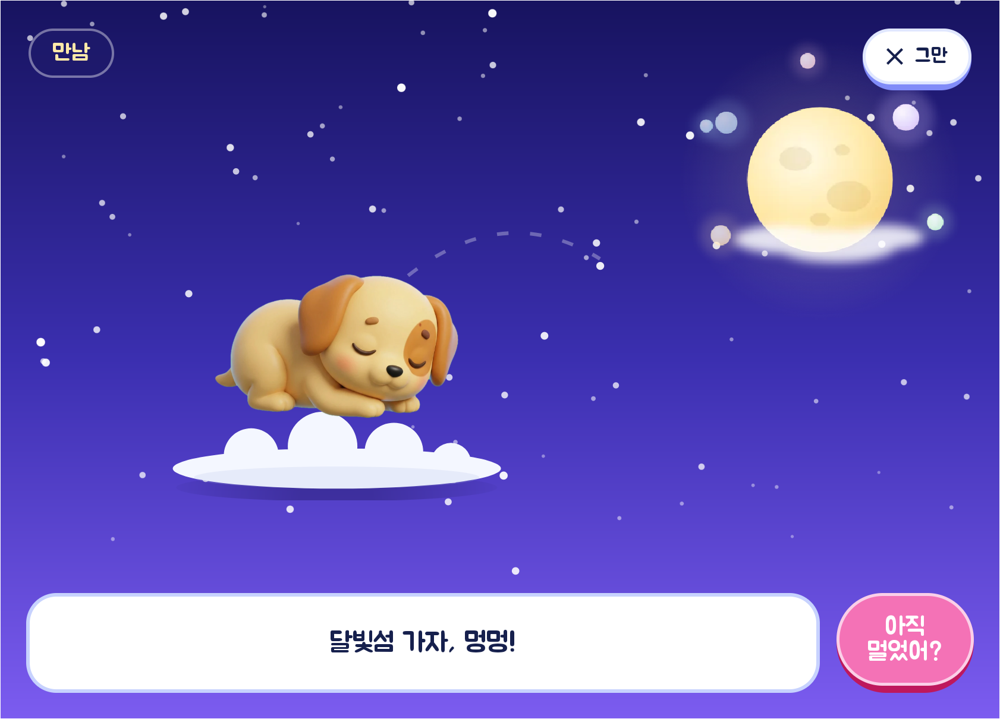
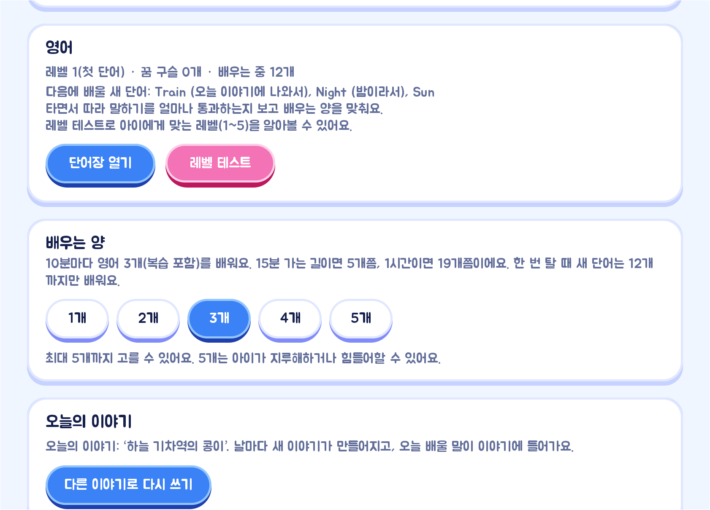

# 멍글리쉬

주행 신호와 목적지까지 남은 시간에 맞춰 생성형 AI가 매일 새로운 영어 동화를 들려주고,
아이가 따라 말한 만큼 구름 강아지가 자라는 차량 전용 오디오 영어 학습 앱입니다(Pleos Connect).


| 항목 | 내용 |
|---|---|
| 팀 | 커맨더아주 |
| 앱 이름 | 멍글리쉬 (v0.2.0, `com.ajikmeoreosseo.app`) |
| 시연 영상 | <https://youtu.be/WAlxAgbftww> (3분 35초) |
| APK 파일 위치 | [`apk/커맨더아주_멍글리쉬_release.apk`](apk/커맨더아주_멍글리쉬_release.apk) |
| 실행 방법 | [APK 내려받기](#apk-내려받기) → [설치와 실행](#설치와-실행) → [사용법](#사용법) |
| 테스트 환경 | Pleos Connect Emulator v2.1.0, 화면 2560×1440 ([아래 표](#테스트-환경-및-필요한-설정)) |

## 주요 기능

1. **매일 새로 쓰는 동화** — 오늘 배울 영어 단어를 넣어 AI(Claude)가 날마다 새 이야기를 쓰고, 목적지까지 남은 시간에 길이를 맞춥니다.
2. **차의 움직임이 이야기가 되는 동화** — 방향지시등, 와이퍼, 브레이크, 내비 안내가 이야기 속 사건이 됩니다. 운전자가 바쁜 순간에는 말하지 않습니다.
3. **동화 사이사이의 영어 수업** — 강아지가 영어를 한 가지씩 가르치고, 아이가 따라 말하면 차가 듣고 통과시킵니다.
4. **레벨 테스트와 다섯 레벨** — AI가 아이의 대답을 보고 문제를 골라 수준(레벨 1~5)을 알아봅니다.
5. **날마다 이어지는 복습** — 어제 배운 단어를 오늘 다시 묻고, 10분마다 몇 개를 배울지 보호자가 정합니다.
6. **배운 만큼 자라는 강아지** — 영어를 배우면 간식이 생기고, "Here you are!"라고 말해 간식을 주면 강아지가 자랍니다.
7. **안전과 마음 챙기기** — 안전벨트를 매야 이야기가 출발하고, 아이가 울면 어른만 아는 비밀 버튼으로 강아지가 달래 줍니다.

| 이야기 속 | 첫 화면에서 말로 간식 주기 | 설정(어른용) |
|---|---|---|
|  |  |  |

## 시연 영상

<https://youtu.be/WAlxAgbftww> (3분 35초)

같은 영상이 저장소에도 있습니다: [`docs/demo/ajik-meoreosseo-demo.mp4`](docs/demo/ajik-meoreosseo-demo.mp4)

## APK 내려받기

아래 가운데 편한 방법을 쓰면 됩니다.

- **웹에서**: [`apk/커맨더아주_멍글리쉬_release.apk`](apk/커맨더아주_멍글리쉬_release.apk)를 열고 오른쪽 위의 내려받기(Download raw file) 버튼을 누릅니다.
- **저장소째로**:

  ```bash
  git clone https://github.com/Commander-AJOU/meonglish.git
  ```

  APK는 `meonglish/apk/` 폴더에 있습니다.

## 설치와 실행

1. Pleos Connect Emulator(v2.1.0)를 켭니다.
2. APK를 설치합니다.

   ```bash
   adb install -r "apk/커맨더아주_멍글리쉬_release.apk"
   ```

3. 에뮬레이터의 앱 목록에서 **멍글리쉬**를 엽니다.
4. 차량 신호를 바꿔 보려면 Pleos Connect Virtual Console을 엽니다.

   ```bash
   adb forward tcp:8088 tcp:8088
   ```

   브라우저에서 <http://127.0.0.1:8088/> 을 열면 Emulation Controls에서 신호를 바꿀 수 있습니다.

## 사용법

### 1. 처음 한 번 (기어 P, 어른이)

오른쪽 위 **설정**을 누릅니다. 설정은 차를 세웠을 때(기어 P)만 열립니다.

- **주인공 이름**: 아이 이름을 넣으면 강아지가 이름을 불러 줍니다.
- **강아지 이름**: 아이가 지어 준 이름으로 바꿉니다(기본 '콩이').
- **레벨 테스트**: 강아지가 우리말로 묻고 아이가 영어로 대답하면, 아이에게 맞는 레벨(1~5)을 정해 줍니다.
  차가 못 들었을 때는 어른이 "알아요" / "몰라요"를 눌러 주면 됩니다.
- **배우는 양**: 10분마다 영어를 몇 개 배울지 1~5개 가운데 고릅니다(기본 3개).
- **오늘 있었던 일**: 한 줄 적어 두면 그 일을 넣어 오늘의 이야기를 다시 씁니다.

### 2. 이야기 듣기

1. 첫 화면에서 **이야기 시작**을 누릅니다.
2. 뒷좌석에 아이가 앉았으면 강아지가 안전벨트를 매 달라고 하고, 매면 출발합니다.
3. 동화의 장과 장 사이에 강아지가 영어를 가르칩니다. "따라 해 볼까?" 하면 아이가 따라 말하고, 차가 들으면 통과입니다.
   차를 세운 상태에서는 어른이 **잘 말했어요**를 눌러 통과시켜 줄 수도 있습니다.
4. **아직 멀었어?** 버튼을 누르면 남은 시간을 이야기 속 말로 대답합니다.
5. 기어를 P에 놓거나 내비가 도착을 알리면 결말을 들려주고 첫 화면으로 돌아옵니다.

### 3. 차량 신호 바꿔 보기 (Virtual Console)

| 바꾸는 신호 | 앱의 반응 |
|---|---|
| Turn Signal State (방향지시등) | 켠 동안 구름이 말없이 기울고, 끄면 3초 뒤 이야기로 받아 줌. 다음 수업에서 Left / Right를 가르침 |
| Windshield Wiper Switch (와이퍼) | 화면과 이야기에 비가 내리고, 다음 수업에서 Rain을 가르침 |
| Brake Pedal (브레이크 4초 이상) | 숨 고르기 놀이, 떼면 "다시 출발" |
| Gear Selection (기어) | D: 주행 중에는 자막을 숨김 / R: 후진 대사 / 달린 뒤 P: 결말 |
| Seat Occupancy (뒷좌석 착석) | 앉았는데 벨트를 안 맸으면 맬 때까지 이야기가 기다림 |
| Door Position (도착 뒤 뒷문) | "천천히 내려요" |

### 4. 강아지 키우기

- 영어를 한 가지 배울 때마다 간식이 하나 생기고, 첫 화면에 모은 개수가 보입니다.
- 첫 화면으로 돌아오면 강아지가 "Here you are!"를 알려 줍니다. 아이가 따라 말하면 간식이 강아지에게 날아가고, 간식 하나에 한 단계씩 자랍니다.
- **콩이네 집**: 강아지가 자랄 때마다 열리는 물건을 눌러 방에 놓습니다.
- **꿈 구슬 도감**(첫 화면의 꿈 구슬 표시): 배운 단어가 카드로 모이고, 누르면 강아지가 읽어 줍니다.

### 5. 아이가 울 때 (어른만 아는 비밀 버튼)

이야기 화면 왼쪽 위의 장 제목을 길게 누르면(달리는 중에는 한 번 톡) 강아지가 읽던 말을 멈추고 아이를 달랜 뒤 이어 읽습니다.

## 테스트 환경 및 필요한 설정

| 항목 | 내용 |
|---|---|
| 실행 환경 | Pleos Connect Emulator v2.1.0 (Android Automotive, Android 14 · API 34) |
| 화면 규격 | 에뮬레이터 화면 2560×1440, 160dpi. 앱 창은 그 안의 1682×1210 영역(가로) |
| 앱 | minSdk 28, targetSdk 34, Kotlin |
| Pleos SDK | Vehicle 2.3.2, TextToSpeech 3.3.1, SpeechToText 3.3.1, NaviHelper 3.0.5 |
| 생성형 AI · 음성 | Claude API(이야기 쓰기, 레벨 테스트 출제), ElevenLabs(강아지 목소리) |

- **뒷좌석 벨트**: 에뮬레이터는 뒷좌석 벨트를 늘 '안 맴'으로 알려 줍니다. **Seat Occupancy의 뒷좌석을 Empty로 둔 채 실행하세요.**
  Occupied로 바꾸면 이야기가 벨트를 기다리며 멈춥니다.
- **마이크**: 에뮬레이터에는 마이크가 없어 따라 말하기는 듣는 시간이 지나면 넘어가고, 간식은 두 번 물어본 뒤 그래도 줍니다.
- **인터넷**: 새 이야기, 레벨 테스트 출제, 강아지 목소리에 씁니다. 연결이 없으면 앱에 든 기본 이야기, 기본 레벨 테스트, 차량 기본 음성으로 끝까지 동작합니다.
- **내비 목적지**(선택): 목적지를 정하면 남은 시간에 맞춰 이야기 길이가 정해집니다. 없어도 이야기는 진행됩니다.
- **권한**: 따로 눌러서 허용할 것은 없습니다.

## 소스에서 빌드

```bash
./gradlew :app:assembleRelease     # app/build/outputs/apk/release/app-release.apk
```

Android Studio로 이 폴더를 열어도 됩니다(JDK 17 이상). API 키 없이 빌드하면 기본 이야기와 차량 기본 음성으로 동작합니다.
키를 넣으려면 `secrets.example.properties`를 `secrets.properties`로 복사해 값을 채웁니다.

## 더 자세한 설명

동작 원리, 영어 진도 규칙, 시험용 도구, 소스 구조, 알려진 한계는 [docs/DETAILS.md](docs/DETAILS.md)에 있습니다.
